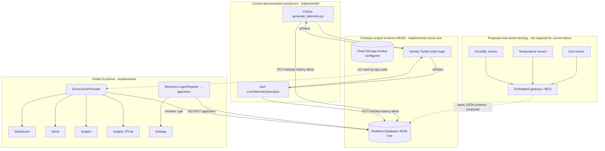
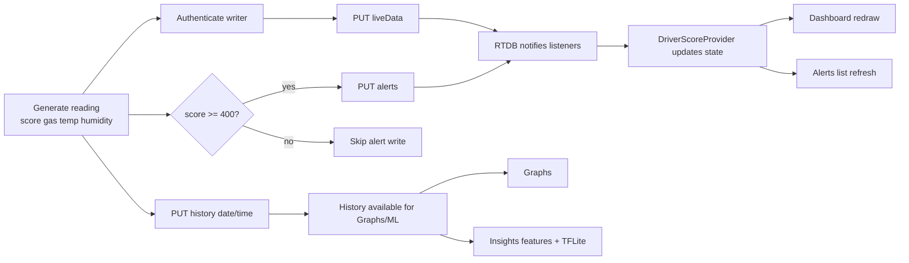
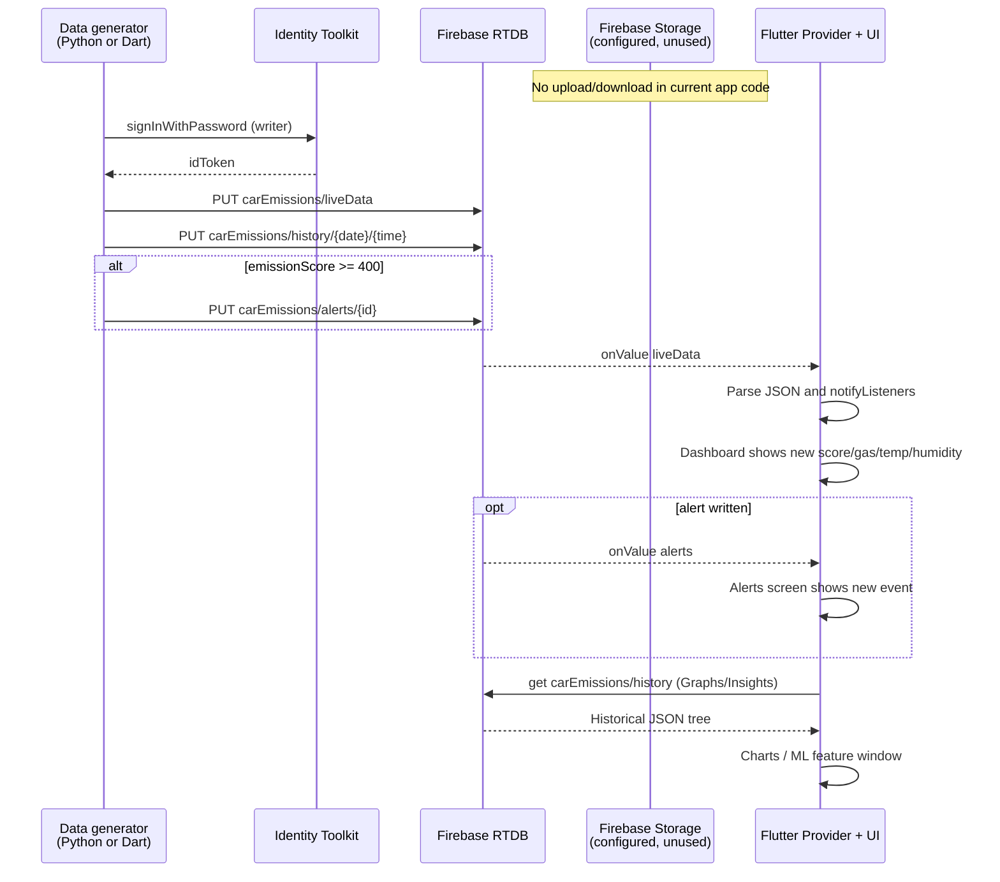

# EcoDrive: Complete System Working and Operational Workflow

**Descriptive Cloud Computing Project Report**

**Title:** EcoDrive: A Cloud-Based Vehicle Emission Monitoring and Intelligent Analytics System  

**Document type:** Operational workflow and system working narrative  
**Companion document:** `EcoDrive_Cloud_Computing_Report.md` (technical cloud focus)  
**Basis:** Inspection of the implemented EcoDrive Flutter / Firebase / Python repository  
**Central theme:** How cloud computing connects sensing (simulated), storage, and mobile monitoring into one working system  

---

## How to Read This Document

This report tells the **complete story of EcoDrive as a working system**. It does not assume the reader has seen the source code or received a verbal walkthrough. Technologies such as Python, Firebase, and Flutter are not treated as isolated tools; they are explained as **cooperating stages** in a single cloud-centred pipeline that answers one practical question:

> *What is the vehicle’s emission condition right now, what has it been over time, and when should the driver be warned?*

Wherever the present academic build uses **software-generated readings** instead of physical sensors, that fact is stated clearly. The **intended real-world acquisition path** (physical sensors → cloud → app) is distinguished from the **current demonstration mechanism** (Python / in-app Dart generators → cloud → app). Firebase Storage is discussed only to the extent that the project configures or implements it; **application code does not implement Firebase Storage uploads or downloads**.

---

## 1. Why EcoDrive Exists

Urban and peri-urban transport contributes continuously to air pollution. Drivers rarely have a live, understandable view of how “dirty” or “clean” their vehicle’s emission-related readings are during ordinary use. Workshop visits and periodic pollution checks are useful, but they are intermittent.

EcoDrive’s purpose is to place emission-related telemetry in the **cloud**, so that:

1. readings are not trapped on a single phone or microcontroller;  
2. a mobile application can show the **latest** condition as soon as it changes;  
3. a **history** remains available for graphs and analytics;  
4. **high-emission episodes** can be recorded as alerts;  
5. optional **on-device machine learning** can summarise recent behaviour.

Cloud computing is what makes those goals practical: Firebase Realtime Database acts as the shared, always-reachable backend. Producers write JSON there; the Flutter application listens and displays. Without the cloud store, the dashboard would only reflect local memory and could not synchronise across sessions or devices in the same way.

---

## 2. Vehicle Emission Data Generation

### 2.1 What the system monitors

Each reading carries four primary quantities, plus a timestamp:

| Parameter | Meaning in EcoDrive | What it represents about the vehicle |
| --- | --- | --- |
| **Raw gas** (`rawGas`) | Numeric intensity associated with gas sensing (demo range roughly 180–750) | Higher values stand for denser / dirtier gas readings—the primary physical signal behind pollution concern |
| **Emission score** (`emissionScore`) | Derived index mapped from raw gas into approximately **50–500** | A human-facing severity scale for the dashboard gauge; higher scores mean worse emission condition |
| **Temperature** (`temperature`) | Ambient / contextual temperature (°C) | Environmental context that accompanies emission readings |
| **Humidity** (`humidity`) | Relative humidity (%) | Environmental context; stored and shown with the same reading |
| **Timestamp** | Date–time string of the sample | Orders history, labels alerts, and anchors graphs |

The emission score is not an independent physical sensor. In the generators it is **computed from raw gas** using a linear mapping between “clean air” and “max smoke” calibration constants (`CLEAN_AIR = 200`, `MAX_SMOKE = 700`), then clamped into the score range. The Flutter gauge treats **500** as the maximum displayable score.

**Status interpretation in the app** (from the live score):

- score ≤ 150 → **GOOD**  
- score ≤ 300 → **MODERATE**  
- above 300 → **POOR**

Thus a rising raw-gas reading pushes the score upward; the user sees both the numeric score and a qualitative band.

### 2.2 Current implementation: simulated continuous sensing

In a production vehicle system, raw gas, temperature, and humidity would come from a **combination of sensors** (for example a gas sensor module, a temperature sensor, and a humidity sensor) attached to an embedded controller that periodically samples and uploads.

**In the current EcoDrive academic implementation, those sensors are not required to run the demonstration.** Instead, software generates values that **look and behave like** continuously changing vehicle conditions:

1. **Python publisher** — `data_generator/generate_telemetry.py`  
   - Runs on a development machine.  
   - Every few seconds (default **3 seconds**), creates a new reading.  
   - Uses scenario profiles (`eco`, `normal`, `aggressive`, `idle`, `critical`, or rotating `mixed`) so gas and environment values drift, spike, and change style over time.  
   - On selected ticks, deliberately forces a peak score of **500** so extreme conditions can be demonstrated.

2. **In-app Dart publisher** — `LiveTelemetrySimulator`  
   - Starts when the Flutter dashboard begins listening.  
   - Implements the same idea on the phone: synthesise a reading, then **upload it to Firebase**, on a similar interval.  
   - Exists so a mobile demo can run even when the Python process is not active.

Both publishers are **data-generation mechanisms for demonstration**. They exist to feed the cloud and prove the monitoring workflow. They are **not** the conceptual heart of EcoDrive; the heart is **cloud storage + real-time mobile observation**. In a real deployment, sensor firmware would replace these generators while keeping the same JSON fields so the Flutter cloud consumers need not change.

### 2.3 What “continuously changing conditions” means operationally

A vehicle’s emission-related signals are not static. Idling, aggressive acceleration, and “eco” driving produce different gas intensities. The generators encode that idea as:

- a baseline level per scenario;  
- small sinusoidal drift and random noise;  
- occasional spikes;  
- periodic scenario rotation in `mixed` mode.

Each tick therefore yields a **new cloud write**, which is what allows the dashboard to appear “live.”

---

## 3. Data Transmission to the Cloud

### 3.1 Packaging a reading

When a generator produces a sample, it assembles a JSON object conceptually equivalent to:

```json
{
  "rawGas": 419.18,
  "temperature": 31.17,
  "humidity": 49.6,
  "emissionScore": 247,
  "timestamp": "2026-11-13 23:47:44"
}
```

That structure is the **contract** between producers and the Flutter app. The app’s live parser expects these field names.

### 3.2 How the upload happens

Transmission uses **HTTPS REST** against Firebase Realtime Database:

1. The publisher signs in to Google Identity Toolkit with a **writer service account** email/password (not the end-user phone login).  
2. It receives a short-lived `idToken`.  
3. It issues authenticated `PUT` requests of the form:  
   `{databaseURL}/{path}.json?auth={idToken}`  
4. Firebase stores the JSON at that path and notifies connected listeners.

This is cloud computing in practice: the phone or PC does not keep the “official” latest reading privately; it **publishes** it to a managed backend that other clients can observe.

### 3.3 Live readings versus historical records

EcoDrive maintains **two complementary cloud representations** of the same sample:

| Store | Path pattern | Behaviour | Why it exists |
| --- | --- | --- | --- |
| **Live** | `carEmissions/liveData` | Each new reading **overwrites** the previous live object | Dashboard needs one authoritative “current” snapshot that always updates in place |
| **History** | `carEmissions/history/{YYYY-MM-DD}/{HH-MM-SS}` | Each reading is written under a **new** time key | Graphs and ML need a time series; overwriting live data alone would destroy the past |

**Why both are required**

- If only live data existed, the user could see the present but not trends, peaks, or ML windows.  
- If only history existed, the dashboard would have to scan and sort the entire tree on every refresh to find “now,” which is heavier and less natural for real-time UI.  

Separating **current state** from **append-only history** is a standard cloud IoT pattern; EcoDrive follows it explicitly in both Python and Dart publishers.

### 3.4 Optional alert write during transmission

If the generated `emissionScore` is **greater than or equal to 400**, the publisher also writes an alert document under `carEmissions/alerts/{date}_{time}`. That threshold is implemented in the generators (`ALERT_THRESHOLD` / `alertThreshold = 400`).  

Separately, the **score scale** and gauge maximum use **500**, and the generators can force a reading of score **500** on certain ticks. A score of 500 therefore exceeds the alert threshold and will create an alert record; **500 is the upper score bound / demo peak, while 400 is the implemented cloud alert-write threshold.**

---

## 4. Cloud Data Storage and Management

### 4.1 Firebase Realtime Database as the centralised backend

Firebase Realtime Database is EcoDrive’s **system of record** for emission monitoring. It is a cloud-hosted NoSQL JSON tree. In this project it centralises:

- the latest vehicle reading;  
- the historical archive;  
- high-emission event logs;  
- custom user profiles used for login.

Because the database is remote and shared:

- the Python generator on a laptop and the Flutter app on a phone can cooperate without a custom server;  
- closing the app does not erase cloud history;  
- reopening the app can resume from the same backend.

That centralisation is the core cloud-computing contribution of EcoDrive.

### 4.2 How new readings are stored

On each publish cycle:

1. `liveData` is replaced with the newest JSON object.  
2. A history node is created for that exact second (or time key).  
3. If the score crosses the alert threshold (≥ 400), an alert node is created.

### 4.3 How previous readings are retained

History nodes are not deleted by the normal publish loop. Older `{date}/{time}` entries remain until manually removed or overwritten by an identical key. This retention is what enables Graphs and Insights to reason over time.

### 4.4 How alert records are maintained

Alert documents persist under `carEmissions/alerts/`. The Flutter provider attaches an `onValue` listener to that path, rebuilds an in-memory list of `EmissionAlert` objects, and the Alerts screen presents them. New high-score events appear as additional children in that tree.

### 4.5 How the Flutter application retrieves updates

| Need | Cloud operation | Result |
| --- | --- | --- |
| Live dashboard | `onValue` on `carEmissions/liveData` | Automatic callback whenever live JSON changes |
| Alert list | `onValue` on `carEmissions/alerts` | Automatic refresh of warning history |
| Graphs / ML window | `get()` on `carEmissions/history` (plus locally appended live points) | Pull of retained series |

The decisive design rule in the implemented provider is that **live UI state is applied from Firebase listener payloads**, not by privately assigning generator values straight into widgets. Generator → cloud comes first; cloud → UI follows.

### 4.6 Firebase Storage

Firebase project options include a `storageBucket` (`ecodrive-85155.firebasestorage.app`). However, **the Flutter application does not implement Firebase Storage**. There is no `firebase_storage` dependency in `pubspec.yaml`, and no upload/download of images or files through Storage APIs in `lib/`.

**Therefore:**

- Storage is **not** part of the current operational workflow for emission monitoring.  
- Emission values travel as **JSON in Realtime Database**, not as image blobs.  
- Any future use of Storage (for example vehicle photos, report PDFs, or firmware logs) should be marked as **proposed**, not as present behaviour.

---

## 5. Emission Monitoring and Alert Generation

### 5.1 Evaluating emission scores

Monitoring has two layers:

1. **Continuous display** — every live reading updates the score gauge and metric cards, regardless of severity.  
2. **Exception recording** — when severity is high enough, a durable alert record is written and shown.

The user therefore always sees the current condition; they additionally see a log when conditions become concerning.

### 5.2 Threshold-based alert mechanism (as implemented)

**Cloud / generator alert write threshold:** `emissionScore >= 400`  
**Score scale maximum / forced demo peak:** `500`  
**Local notification check in the provider:** also keyed off scores above **400** (with a cooldown so notifications are not spammed every few seconds)

When a publisher detects score ≥ 400, it writes:

```json
{
  "emissionScore": 408,
  "message": "High emission event",
  "timestamp": "..."
}
```

to `carEmissions/alerts/...`.

On the Alerts screen, history cards emphasise severity visually (for example stronger styling when scores are very high, such as above 450 in the UI presentation logic). Insights recommendations may also refer to scores above 400 as high-emission situations when ML labels are unavailable.

### 5.3 How users see alerts

1. RTDB alert listener updates `DriverScoreProvider.alertLogs`.  
2. The Alerts tab shows a count of warnings, current sensor-like values, guidance text based on score bands, and a scrollable alert history.  
3. Optional local notifications may fire for high scores according to the provider’s threshold logic.

The cloud is what makes the alert list durable: the event is stored remotely, not only briefly flashed on screen.

---

## 6. Flutter Application and User Interaction

### 6.1 What happens when the user opens the application

1. **Firebase initialises** (`Firebase.initializeApp` with project options for `ecodrive-85155`).  
2. **`AuthGate`** checks for a saved local session.  
3. If the user is not logged in, **Welcome / Login / Register** appears. Registration stores a profile under `appUsers/{10-digit-phone}` in RTDB (hashed password) and saves a local session; login verifies phone + password against that cloud document.  
4. After authentication, **MainNavigationScreen** opens with five tabs: Dashboard, Alerts, Graphs, Insights, Settings.

### 6.2 Dashboard and Firebase

Opening (or refreshing) the Dashboard triggers `startListening()`:

- subscribe to `liveData`;  
- subscribe to `alerts`;  
- start the in-app Firebase writer (simulator) if needed.

When Firebase pushes a new live snapshot, the provider parses `emissionScore`, `rawGas`, `temperature`, `humidity`, and `timestamp`, then notifies listeners. The Dashboard rebuilds the gauge and metric cards from that cloud-derived state. A pollution-check reminder on the Dashboard is a **local scheduling feature** (SharedPreferences + local notifications), not an RTDB emission record.

**Relationship:** Dashboard = real-time consumer of `carEmissions/liveData` (+ reminder UX).

### 6.3 Graphs and Firebase

The Graphs screen requests history from Firebase (`carEmissions/history`), combines it with available in-memory points, and draws:

- emission score over time (axis up to 500);  
- raw gas and temperature over time.

Time filters (1 hour / 24 hours / 7 days) apply to the loaded series on the device.

**Relationship:** Graphs = visualisation of retained cloud (and live-accumulated) history.

### 6.4 Alerts and Firebase

The Alerts screen reads `alertLogs` maintained by the Firebase alerts listener and the current live score/values from the same provider.

**Relationship:** Alerts = presentation of `carEmissions/alerts` plus live context from `liveData`.

### 6.5 Insights and Firebase / local ML

Insights waits until enough history points exist (at least **20**). It then runs on-device TensorFlow Lite models using features computed from recent emission and gas series. Predictions do not require a separate ML cloud API in the current build; cloud’s role is to supply the time series that features are built from.

**Relationship:** Insights = edge analytics on history that originated from cloud-published readings.

### 6.6 Settings and Firebase

Settings shows the logged-in profile (name, phone, car number) and logout. Logout clears the local session and stops listening/writing. User documents themselves remain in RTDB until deleted outside this flow.

**Relationship:** Settings = account surface for `appUsers` session data.

---

## 7. Intelligent Analytics

### 7.1 From history to features

When enough `HistoryPoint` samples are available, `MlInsightsService` extracts statistical features from the emission-score and raw-gas series, including means, standard deviations, spike frequency/count, recovery-related measures, idle-ratio estimates, baseline drift, sustained-high ratio, and variance. Features are standardised using preprocessing parameters shipped with the model assets, then passed into TFLite interpreters.

### 7.2 Predictions produced

Two model families are loaded from app assets:

- **Driver behaviour** model → label + confidence (and class probabilities).  
- **Vehicle health** model → label + confidence (and class probabilities).

The Insights UI shows these labels, confidence bars, and suggested actions (for example smoother acceleration for aggressive patterns, or maintenance guidance for concerning vehicle labels). If models cannot yet run, the UI explains that more readings are needed.

### 7.3 Purpose and interpretation

Predictions are **decision-support summaries**, not legal certifications of pollution compliance. Their purpose is to turn a stream of cloud-backed numbers into short behavioural or maintenance cues. Cloud computing enables the data volume and continuity; on-device ML keeps inference responsive and offline-capable after data has arrived.

---

## 8. Complete End-to-End Example

The following walkthrough uses the **actual implemented thresholds and paths**. It assumes the Flutter app is logged in and the Dashboard has started its Firebase listener. Data may be produced by the Python script, the in-app simulator, or—in a future deployment—vehicle sensors writing the same JSON.

### Stage A — Normal condition

1. A reading is generated with a moderate raw-gas value.  
2. The emission score maps to a mid/low value (for example below 300), so status may show **GOOD** or **MODERATE**.  
3. The publisher authenticates to obtain an ID token.  
4. It `PUT`s the JSON into `carEmissions/liveData`.  
5. It also `PUT`s the same payload under `carEmissions/history/{today}/{time}`.  
6. Because the score is below **400**, **no** alert document is written.  
7. Firebase notifies the Flutter `onValue` listener.  
8. `DriverScoreProvider` applies the payload and calls `notifyListeners()`.  
9. The Dashboard gauge and cards redraw with the new score, gas, temperature, and humidity.

### Stage B — Worsening condition and alert

10. Later, a new reading is generated with much higher raw gas.  
11. The computed emission score rises sharply—possibly to the demo peak of **500**, which is above the alert threshold.  
12. The publisher again updates `liveData` and appends history.  
13. Because `emissionScore >= 400`, it also writes `carEmissions/alerts/{date}_{time}` with message `"High emission event"`.  
14. The live listener updates the Dashboard (gauge moves toward the high end of the 0–500 scale; status becomes **POOR** if above 300).  
15. The alerts listener refreshes `alertLogs`.  
16. On the Alerts tab, the warning count increases and a new history card appears with score and timestamp.  
17. On the Graphs tab (after history is available), the new point appears in the emission and gas series, so the spike is visible over time.  
18. On Insights, once enough points exist, feature extraction may reflect higher means/spike activity, potentially changing ML labels and recommendations.

### Stage C — Role of each component in that story

| Component | Role in the example |
| --- | --- |
| Generator (Python/Dart) or future sensors | Creates the changing physical story as numbers |
| Identity Toolkit token | Authorises cloud writes |
| Firebase RTDB `liveData` | Holds “what is true right now” |
| Firebase RTDB `history` | Remembers the journey for graphs/ML |
| Firebase RTDB `alerts` | Remembers exceptional events |
| `DriverScoreProvider` | Bridges cloud events into app state |
| Dashboard / Alerts / Graphs / Insights | Turn cloud state into human understanding |
| Firebase Storage | **Not involved** in this implemented path |

---

## 9. Architecture and Data Flow Diagrams

### 9.1 Complete system architecture (actual + clearly marked proposed)



### 9.2 End-to-end data flow (implemented monitoring path)



### 9.3 Sequence diagram (generator ↔ RTDB ↔ Flutter)

Firebase Storage is shown only as an unused/configured peer so the diagram matches the instruction to include it **where applicable** and mark what is not active.



---

## 10. What the User Ultimately Gains

From the user’s point of view, EcoDrive converts an invisible process—changing emission-related conditions—into:

- a **live gauge and metrics** that move when the cloud updates;  
- **graphs** that reveal spikes and trends;  
- an **alert history** when scores become severe (≥ 400 in the implemented publishers);  
- **insights** that summarise recent behaviour once enough cloud-backed history exists;  
- an **account-bound vehicle identity** (phone login + car number) stored in the cloud user tree.

Cloud computing is the reason those gains are possible without building a custom always-on application server: Firebase Realtime Database provides remote persistence, fan-out of live updates, and a shared JSON model that both simulators and future sensors can speak.

---

## 11. Closing Summary of the Working System

EcoDrive’s operational truth is simple once the pieces are connected:

1. **Something** must produce emission-related readings (today: Python/Dart simulation; tomorrow: sensors).  
2. Those readings are **uploaded as JSON** to Firebase Realtime Database as both **live state** and **history**, with **alerts** when scores are high.  
3. Flutter **does not invent the live truth locally**; it **subscribes to the cloud** and renders Dashboard, Alerts, Graphs, and Insights from that shared state.  
4. Machine learning, where used, **interprets the resulting time series on the device**.  
5. Firebase Storage is **configured at project level but not part of the implemented emission workflow**.

That is the complete working story of EcoDrive as a cloud-based vehicle emission monitoring and intelligent analytics system.

---

*End of descriptive report.*

**Saved as:** `EcoDrive_Cloud_Computing_Descriptive_Report.md`
