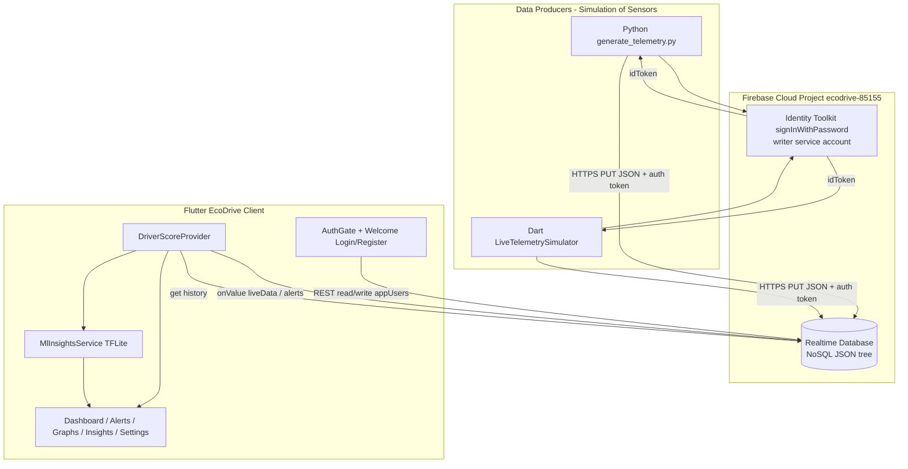
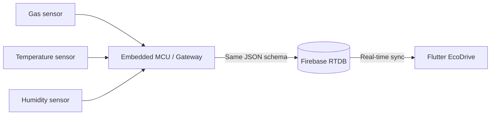
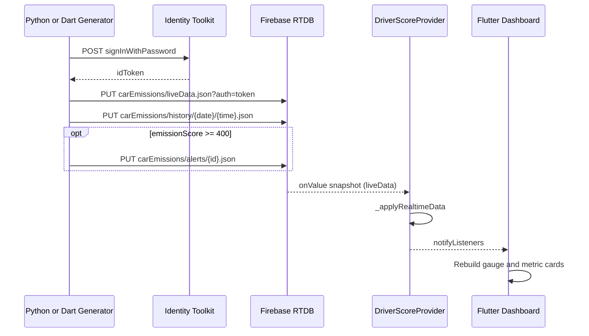
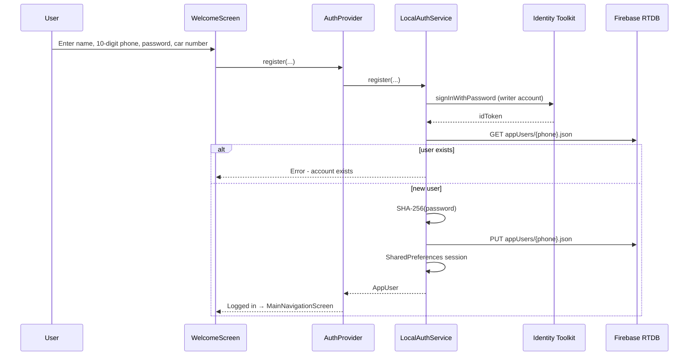

# EcoDrive: A Cloud-Based Vehicle Emission Monitoring and Intelligent Analytics System

**Academic Cloud Computing Project Report**

| Field | Detail |
| --- | --- |
| Project title | EcoDrive: A Cloud-Based Vehicle Emission Monitoring and Intelligent Analytics System |
| Application stack | Flutter (Dart), Firebase Realtime Database, Python telemetry tooling, on-device TensorFlow Lite |
| Cloud project | Firebase project `ecodrive-85155` |
| Realtime Database URL | `https://ecodrive-85155-default-rtdb.firebaseio.com` |
| Report basis | Inspection of the existing EcoDrive repository source code (no invented features or metrics) |

---

## Abstract

EcoDrive is a mobile application that monitors vehicle emission-related telemetry through a cloud-centred data path. Sensor-like readings—raw gas intensity, temperature, humidity, and a derived emission score—are written into **Firebase Realtime Database (RTDB)** and consumed by a Flutter client that updates gauges, graphs, alerts, and machine-learning insights in near real time.

In the present academic implementation, physical sensors are **substituted by software generators** (a Python script and/or an in-app Dart publisher). These generators produce JSON payloads equivalent to what gas, temperature, and humidity sensors would supply in a production Internet of Things (IoT) deployment. The Flutter user interface is deliberately designed so that **display logic depends only on Firebase listeners and reads**, preserving a cloud-first architecture even when synthetic data is used for demonstration.

This report documents the system architecture, cloud data model, authentication approach, Flutter modules, on-device analytics, cloud computing concepts demonstrated, limitations, and future scope, based solely on the inspected codebase.

---

## Table of Contents

1. [Introduction and Problem Statement](#1-introduction-and-problem-statement)  
2. [Project Overview and Objectives](#2-project-overview-and-objectives)  
3. [System Architecture and End-to-End Data Flow](#3-system-architecture-and-end-to-end-data-flow)  
4. [Firebase and Cloud Data Platform](#4-firebase-and-cloud-data-platform)  
5. [JSON Structures, Paths, Reads, Writes, and Synchronisation](#5-json-structures-paths-reads-writes-and-synchronisation)  
6. [Python Data Generation and Firebase Communication](#6-python-data-generation-and-firebase-communication)  
7. [Flutter Application Modules](#7-flutter-application-modules)  
8. [Technical Implementation: Authentication and Security](#8-technical-implementation-authentication-and-security)  
9. [Cloud Computing Concepts Demonstrated](#9-cloud-computing-concepts-demonstrated)  
10. [Intelligent Analytics and Machine Learning](#10-intelligent-analytics-and-machine-learning)  
11. [Testing Observations, Limitations, Future Scope, and Conclusion](#11-testing-observations-limitations-future-scope-and-conclusion)  
12. [References to Repository Artefacts](#12-references-to-repository-artefacts)  
13. [Appendix: Source Code Anchors](#13-appendix-source-code-anchors)

---

## 1. Introduction and Problem Statement

Vehicle emissions contribute to urban air pollution and public-health risk. Continuous monitoring of cabin or exhaust-related gas indicators, together with environmental context (temperature and humidity), can help drivers and workshops recognise deteriorating vehicle behaviour earlier than intermittent manual checks alone.

Traditional monitoring approaches often keep data on the vehicle or on a local device, limiting remote accessibility and multi-device synchronisation. A **cloud-based** design stores the latest reading and historical series in a managed NoSQL store, allowing any authorised client to observe the same live state.

EcoDrive addresses this need by:

- treating emission telemetry as **cloud-resident state**;
- streaming updates to a mobile dashboard through Firebase RTDB listeners;
- retaining history and high-emission events in the cloud;
- optionally applying **on-device** machine learning to recent history for driver-behaviour and vehicle-health labels.

### 1.1 Role of Software Generators versus Physical Sensors

It is essential to distinguish demonstration tooling from a production sensing stack:

| Layer | Current academic system | Intended real-world system |
| --- | --- | --- |
| Sensing | Python script (`data_generator/generate_telemetry.py`) and/or in-app `LiveTelemetrySimulator` synthesise `rawGas`, `temperature`, `humidity`, and `emissionScore` | A combination of gas (e.g. MQ-series / NDIR), temperature, and humidity sensors on an embedded node (ESP32/Arduino or OBD-linked ECU bridge) |
| Transport to cloud | HTTPS REST `PUT` into Firebase RTDB (JSON) | Same RTDB (or MQTT bridge → cloud function → RTDB); payload schema remains compatible |
| Application | Flutter reads **only** from Firebase | Unchanged: UI remains cloud-driven |

Thus, Python (and the Dart publisher) exist to **exercise the cloud and mobile pipeline**. The application’s correct operational model remains: **sensors → cloud → app**.

---

## 2. Project Overview and Objectives

### 2.1 Overview

EcoDrive is implemented as a Flutter application (`pubspec.yaml` package name `ecodrive`) initialised with Firebase Core (`lib/main.dart`, `lib/firebase_options.dart`). After a custom login session, the user navigates five primary modules: Dashboard, Alerts, Graphs, Insights (on-device ML), and Settings.

Telemetry is organised under the RTDB root path `carEmissions/`, with user profiles under `appUsers/`.

### 2.2 Objectives

1. **Cloud-centric live monitoring** — publish emission-related readings to Firebase RTDB and reflect them on the dashboard without local-only UI mutation as the source of truth.  
2. **Historical persistence** — store timestamped readings under date/time keys for later graphing and ML feature windows.  
3. **Alerting** — record high emission events when the score meets or exceeds a configured threshold (400 in the generators).  
4. **Accessible multi-client design** — any Flutter instance connected to the same database URL can observe shared live state.  
5. **Intelligent assistance** — run TensorFlow Lite models on-device using recent history points.  
6. **Academic cloud demonstration** — exhibit NoSQL document trees, real-time synchronisation, remote persistence, and scalability-oriented separation of producers and consumers.

### 2.3 Non-objectives (as observed in code)

- The Flutter `pubspec.yaml` depends on `firebase_core` and `firebase_database` only; **`firebase_storage` is not a runtime dependency**, and no Dart file in `lib/` invokes Firebase Storage APIs. A `storageBucket` field appears in FlutterFire options for project configuration completeness, but **Firebase Storage is not implemented in application logic**.  
- End-user accounts are **not** created via the Firebase Authentication user SDK; they are stored as RTDB documents under `appUsers/` with hashed passwords (`LocalAuthService`).

---

## 3. System Architecture and End-to-End Data Flow

### 3.1 Logical Architecture



### 3.2 Conceptual Production Architecture (Sensors)



In the repository, `MCU` is replaced by Python/Dart generators that emit the **same fields** the Flutter parser expects (`rawGas`, `temperature`, `humidity`, `emissionScore`, `timestamp`).

### 3.3 Runtime Data Flow (Demonstration Mode)

1. Flutter initialises Firebase (`main.dart`).  
2. User registers or logs in; profile is stored under `appUsers/{phone}` and a local session is saved (`SharedPreferences`).  
3. On dashboard start, `DriverScoreProvider.startListening()` attaches an `onValue` listener to `carEmissions/liveData` and starts the in-app writer `LiveTelemetrySimulator` (unless already running).  
4. Independently, an operator may run `python3 data_generator/generate_telemetry.py`, which also writes the same RTDB paths.  
5. Each write updates `liveData`, appends a history node, and optionally creates an alert node.  
6. The listener fires; `_applyRealtimeData` updates score, gas, temperature, humidity, and notifies UI widgets.  
7. Graphs and Insights call `fetchHistory()` and/or use the in-memory history buffer built from live updates.  
8. Insights runs TFLite inference once sufficient history points are available (minimum 20 in `MlInsightsScreen`).

### 3.4 Sequence Diagram: Live Telemetry Update



### 3.5 Sequence Diagram: Custom User Registration



---

## 4. Firebase and Cloud Data Platform

### 4.1 Firebase project binding

FlutterFire configuration (`lib/firebase_options.dart`) binds the app to project **`ecodrive-85155`**, with platform-specific API keys and the shared:

- `databaseURL`: `https://ecodrive-85155-default-rtdb.firebaseio.com`
- `storageBucket`: `ecodrive-85155.firebasestorage.app` (configured, **not used by app code**)

Android client configuration is also present in `android/app/google-services.json`.

### 4.2 Firebase Realtime Database (primary cloud store)

RTDB is used as a hierarchical JSON document store. The application and generators interact with it in two ways:

| Client | Mechanism | Purpose |
| --- | --- | --- |
| Flutter `firebase_database` | `DatabaseReference.onValue`, `.get()` | Live subscription and history fetch |
| Python / Dart REST writers | HTTPS `PUT` to `{dbUrl}/{path}.json?auth={idToken}` | Publish telemetry and user documents |

`DriverScoreProvider` obtains a database reference via:

```dart
FirebaseDatabase.instanceFor(
  app: Firebase.app(),
  databaseURL: _databaseUrl,
).ref();
```

### 4.3 Firebase Storage

**Finding from code inspection:** Firebase Storage is **not implemented** in the EcoDrive Flutter application. There is no `firebase_storage` dependency in `pubspec.yaml` and no Storage upload/download calls under `lib/`. The storage bucket field in Firebase options indicates project provisioning only.

For this report, cloud storage concepts are therefore demonstrated primarily through **RTDB persistence of JSON telemetry and user records**, not through Cloud Storage for Firebase object blobs. Future work may store firmware logs or images in Storage; that is out of scope of the present code.

### 4.4 Identity Toolkit usage (writer access)

Telemetry publishers and the custom auth service obtain short-lived ID tokens by calling Google Identity Toolkit:

`https://identitytoolkit.googleapis.com/v1/accounts:signInWithPassword?key=...`

using a shared writer email (hard-coded in generators/services as `ecodrive@test.com`). This token authorises RTDB REST writes. This is **infrastructure authentication for cloud writes**, distinct from end-user login stored under `appUsers/`.

---

## 5. JSON Structures, Paths, Reads, Writes, and Synchronisation

### 5.1 Database path map

```text
ecodrive-85155-default-rtdb
├── carEmissions/
│   ├── liveData/                 # latest single reading (overwritten each publish)
│   ├── history/
│   │   └── {YYYY-MM-DD}/
│   │       └── {HH-MM-SS}/       # immutable point-in-time reading
│   └── alerts/
│       └── {date}_{time}/        # high-emission event records
└── appUsers/
    └── {10-digit-phone}/         # custom user profile + passwordHash
```

### 5.2 Live telemetry JSON example

Written by both Python `publish_reading` and Dart `_publishOnce`:

```json
{
  "rawGas": 419.18,
  "temperature": 31.17,
  "humidity": 49.6,
  "emissionScore": 247,
  "timestamp": "2026-11-13 23:47:44"
}
```

**Semantics**

- `rawGas`: synthetic stand-in for gas-sensor intensity (clamped approximately 180–750 in generators).  
- `temperature` / `humidity`: environmental context fields.  
- `emissionScore`: derived integer score mapped from raw gas into approximately 50–500 (generators force 500 on selected ticks for demonstration).  
- `timestamp`: local formatted string used by the Flutter parser.

### 5.3 Alert JSON example

When `emissionScore >= 400`:

```json
{
  "emissionScore": 408,
  "message": "High emission event",
  "timestamp": "2026-11-13 23:47:47"
}
```

Path example: `carEmissions/alerts/2026-11-13_23-47-47`.

### 5.4 User profile JSON example

```json
{
  "username": "9876543210",
  "name": "Rahul",
  "phone": "9876543210",
  "carNumber": "MH12AB1234",
  "passwordHash": "<sha256-hex>",
  "createdAt": "2026-11-14T00:00:00.000"
}
```

Path: `appUsers/9876543210`.

### 5.5 Cloud writes

**Telemetry (Python):** `FirebaseRestClient.put(path, payload)` → `PUT {dbUrl}/{path}.json?auth={token}`.

**Telemetry (Dart):** `LiveTelemetrySimulator._put` performs the analogous HTTP PUT.

**Users:** `LocalAuthService._put('appUsers/$username', ...)`.

### 5.6 Cloud reads and real-time synchronisation

| Path | Flutter API | Behaviour |
| --- | --- | --- |
| `carEmissions/liveData` | `_liveRef.onValue.listen` | Continuous sync; each remote change rebuilds dashboard state |
| `carEmissions/alerts` | `_alertsRef.onValue.listen` | Keeps alert history list updated |
| `carEmissions/history` | `_historyRef.get()` | One-shot pull for graphs / ML preparation |
| `appUsers/{phone}` | REST GET during login/register | Credential verification |

The architectural rule enforced in comments and structure of `DriverScoreProvider` is that **UI state for live gauges is driven by Firebase events**, not by directly applying simulator values to widgets.

### 5.7 Emission score mapping (producer side)

Both generators share the calibration idea (aligned with former firmware constants):

- `CLEAN_AIR = 200`, `MAX_SMOKE = 700`
- \( t = (rawGas - 200) / (700 - 200) \)
- \( score = round(50 + t \cdot 450) \) clamped to \([50, 500]\)

Dashboard status bands in Flutter (`DriverScoreProvider.status`):

- score ≤ 150 → `GOOD`
- score ≤ 300 → `MODERATE`
- otherwise → `POOR`

---

## 6. Python Data Generation and Firebase Communication

### 6.1 Purpose

`data_generator/generate_telemetry.py` is a **cloud data producer**. It does not render UI. Its responsibility is to:

1. synthesise plausible multi-parameter readings under named driving scenarios (`eco`, `normal`, `aggressive`, `idle`, `critical`, or rotating `mixed`);  
2. authenticate to Firebase via Identity Toolkit;  
3. publish to `liveData`, `history`, and conditionally `alerts`.

### 6.2 Scenario model

Each scenario defines Gaussian centres/spreads for raw gas, spike probability, temperature, and humidity centres. The `mixed` mode periodically rotates profiles. Selected ticks force a peak score of 500 to exercise alert and gauge extremes.

### 6.3 Communication stack

```text
TelemetryGenerator.next_reading()
        │
        ▼
publish_reading(client, reading)
        │
        ├── PUT carEmissions/liveData
        ├── PUT carEmissions/history/{date}/{time}
        └── PUT carEmissions/alerts/...  (if score ≥ 400)
```

Default interval: **3 seconds** (CLI `--interval`).

### 6.4 Relationship to in-app Dart publisher

The Flutter class `LiveTelemetrySimulator` mirrors the Python publisher so a phone can demonstrate the full pipeline without a PC process. Both are **stand-ins for sensor firmware**. In a sensor-based deployment, either publisher would be removed or replaced by embedded firmware writing the same JSON paths.

### 6.5 Offline ML data fetch (secondary Python path)

Under `ML/scripts/01_fetch_firebase.py`, training pipelines can download nested history into `ML/data/firebase_history.json` via `ecodrive_ml.firebase_loader.fetch_history`. This supports offline model development; it is separate from the live mobile path.

---

## 7. Flutter Application Modules

Entry: `AuthGate` → `WelcomeScreen` (login/register) → `MainNavigationScreen` with five tabs (`lib/main.dart`).

### 7.1 Dashboard

**File:** `lib/screens/dashboard_screen.dart`  
**State:** `DriverScoreProvider`

Responsibilities:

- Start Firebase listening and the in-app cloud writer.  
- Show emission gauge (0–500), raw gas, humidity, temperature.  
- Show pollution-check reminder (local schedule via `SettingsService` + `NotificationService`, not RTDB).  
- Bind vehicle plate from the logged-in user’s car number when available.

### 7.2 Alerts

**File:** `lib/screens/alerts_screen.dart`

Displays overall emission score/status, count of logged warnings from `provider.alertLogs` (populated by RTDB `alerts` listener), health recommendation text derived from score bands, current sensor-like values, and alert history cards.

### 7.3 Graphs

**File:** `lib/screens/graphs_screen.dart`

Fetches history (`fetchHistory`) and charts emission score versus time and dual series for raw gas and temperature using `fl_chart`, with filters for last 1 hour / 24 hours / 7 days applied to the in-memory history list.

### 7.4 Insights (ML)

**File:** `lib/screens/ml_insights_screen.dart`  
**Service:** `lib/services/ml_insights_service.dart`

Uses on-device TFLite assets:

- `ML/models/driver_model.tflite` + preprocess/classes  
- `ML/models/vehicle_model.tflite` + preprocess/classes  

Requires at least **20** history points before inference. Outputs labelled predictions with confidence and suggested actions.

### 7.5 Settings

**File:** `lib/screens/settings_screen.dart`

Shows account profile fields (name, phone, car number), app metadata, and logout (clears local session and stops listening/writing).

---

## 8. Technical Implementation: Authentication and Security

### 8.1 End-user authentication (custom, RTDB-backed)

Implemented in `LocalAuthService` / `AuthProvider` / `WelcomeScreen`:

| Aspect | Implementation |
| --- | --- |
| Registration fields | Name, 10-digit phone, password (≥4 chars), car number |
| Login fields | Phone (10 digits) + password |
| Password storage | SHA-256 hex digest (`crypto` package), field `passwordHash` |
| Identity key | Normalised phone digits as RTDB child key |
| Session | `SharedPreferences` keys for username/name/phone/car |
| Firebase Auth SDK for users | **Not used** |

Login compares the hash of the entered password with the stored hash after a REST GET of `appUsers/{phone}`.

### 8.2 Writer authentication

Telemetry and user CRUD REST calls use a shared email/password against Identity Toolkit to obtain `idToken`, appended as `?auth=` on RTDB URLs. This pattern enables writes without the Firebase Admin SDK.

### 8.3 Security observations (academic honesty)

- Writer credentials and API keys appear in client/Python source (typical of student demos; **not production-safe**).  
- Custom password hashing without salting/peppering and without Firebase Auth rate limiting is weaker than managed Auth.  
- RTDB security rules are not versioned as an audited rules file in the inspected app tree; production systems must enforce least-privilege rules so clients cannot read arbitrary `appUsers` password hashes.  
- Transport security relies on HTTPS to Google endpoints.

These points are limitations of the current academic build, not claimed hardened production controls.

---

## 9. Cloud Computing Concepts Demonstrated

| Concept | How EcoDrive demonstrates it |
| --- | --- |
| **Cloud storage of application state** | Telemetry and users persist in Firebase RTDB independently of any single phone |
| **NoSQL document/tree database** | Hierarchical JSON paths (`carEmissions/...`, `appUsers/...`) without relational schemas |
| **Real-time synchronisation** | RTDB `onValue` push model updates all listeners when `liveData` changes |
| **Persistence** | History and alerts remain available after the producer stops (until deleted) |
| **Accessibility** | Any configured Flutter client with network access can observe the same DB URL |
| **Decoupling of producers and consumers** | Python/Dart/future sensors write; Flutter only consumes via cloud |
| **Elasticity / scalability potential** | Stateless mobile clients + managed RTDB; additional vehicles could use namespaced paths (e.g. per plate) without redesigning UI patterns |
| **Managed identity for service writes** | Identity Toolkit tokens for REST publishers |
| **Edge analytics with cloud data** | History sourced from cloud/live buffer; inference executed on device (hybrid cloud–edge) |

**Not demonstrated in code:** Firebase Storage object lifecycle, Cloud Functions, multi-region replication configuration, or formal autoscaling benchmarks.

---

## 10. Intelligent Analytics and Machine Learning

### 10.1 Training-side (repository `ML/`)

Offline scripts prepare datasets (including fetch from Firebase history), generate synthetic sessions, train driver/vehicle models, and export TFLite plus preprocessing JSON. This pipeline supports model creation; the mobile app consumes the exported artefacts as Flutter assets.

### 10.2 Inference-side (on device)

`MlInsightsService`:

1. Loads TFLite interpreters and standardisation parameters from assets.  
2. Builds feature vectors from a window of `HistoryPoint` values.  
3. Returns `MlPrediction` (label, confidence, probability map) for driver behaviour and vehicle health.  
4. `MlInsightsScreen` presents results and heuristic recommendations based on labels/score.

This is **edge ML** fed by **cloud-sourced or cloud-mirrored time series**, not server-side AutoML.

---

## 11. Testing Observations, Limitations, Future Scope, and Conclusion

### 11.1 Testing observations (qualitative, from architecture—not invented metrics)

The codebase supports manual verification paths such as:

- running the Flutter app and confirming debug logs of the form `Firebase update received` after simulator pushes;  
- running the Python generator with `--dry-run` versus live push;  
- registering a 10-digit phone user and confirming an `appUsers` node;  
- observing alerts when scores cross 400.

No automated unit/integration test suite results are asserted in this report because no formal test-result artefacts were used as evidence.

### 11.2 Limitations

1. Synthetic sensing rather than calibrated physical sensors.  
2. Possible concurrent writers (Python + in-app simulator) may interleave updates.  
3. Firebase Storage unused despite bucket configuration.  
4. Custom auth and embedded secrets are unsuitable for production hardening.  
5. History tree is nested by date/time; client flattening logic must remain consistent with that layout for analytics quality.  
6. ML quality depends on training data coverage; on-device models require sufficient live history before predictions appear.

### 11.3 Future scope

1. Replace generators with embedded sensor firmware publishing the same JSON schema.  
2. Namespace RTDB paths per vehicle ID / VIN for multi-fleet monitoring.  
3. Introduce Firebase Auth + Security Rules; move secrets to Cloud Functions or IoT Core.  
4. Optionally use Firebase Storage for raw CSV exports, firmware images, or snapshots.  
5. Add Cloud Functions for server-side anomaly detection and push notifications (FCM).  
6. Formal load testing of concurrent listeners and write rates.

### 11.4 Conclusion

EcoDrive demonstrates a coherent **cloud computing** application pattern: producers publish emission-related JSON to **Firebase Realtime Database**, and a Flutter consumer renders live and historical views exclusively from that cloud state. Python and Dart generators temporarily emulate the sensor layer so the cloud–mobile contract can be validated in an academic setting. Custom user records, real-time listeners, historical persistence, alerting, and on-device TFLite analytics together illustrate a practical hybrid of cloud data management and edge intelligence. With physical sensors substituted for the generators—and with strengthened security—the same architecture extends naturally toward a production vehicle-emission monitoring service.

---

## 12. References to Repository Artefacts

| Artefact | Path |
| --- | --- |
| App entry / navigation | `lib/main.dart` |
| Auth gate | `lib/screens/auth_gate.dart` |
| Login/Register UI | `lib/screens/welcome_screen.dart` |
| Custom auth + RTDB users | `lib/services/local_auth_service.dart` |
| Live Firebase consumer + writer start | `lib/providers/driver_score_provider.dart` |
| In-app telemetry publisher | `lib/services/live_telemetry_simulator.dart` |
| Python telemetry publisher | `data_generator/generate_telemetry.py` |
| Dashboard / Alerts / Graphs / Insights / Settings | `lib/screens/*.dart` |
| On-device ML | `lib/services/ml_insights_service.dart`, `ML/models/*` |
| Firebase options | `lib/firebase_options.dart` |
| Dependencies | `pubspec.yaml` |

---

## 13. Appendix: Source Code Anchors

### A. Flutter live listener (cloud → UI)

```dart
// lib/providers/driver_score_provider.dart (excerpt)
_liveRef ??= _databaseRef!.child('carEmissions/liveData');
_liveSubscription = _liveRef!.onValue.listen((event) {
  final data = event.snapshot.value;
  if (data == null) return;
  _applyRealtimeData(data, source: 'FIREBASE');
});
```

### B. Dart cloud write of live + history + alerts

```dart
// lib/services/live_telemetry_simulator.dart (excerpt)
await _put('carEmissions/liveData', payload);
await _put(
  'carEmissions/history/${reading['dateFolder']}/${reading['timeKey']}',
  payload,
);
if (score >= alertThreshold) {
  await _put('carEmissions/alerts/$alertId', { ... });
}
```

### C. Python publish path

```python
# data_generator/generate_telemetry.py (excerpt)
client.put("carEmissions/liveData", payload)
history_path = f"carEmissions/history/{reading['dateFolder']}/{reading['timeKey']}"
client.put(history_path, payload)
```

### D. Custom user persistence

```dart
// lib/services/local_auth_service.dart (excerpt)
await _put(
  'appUsers/$username',
  user.toJson(passwordHash: hashPassword(password)),
);
```

---

*End of report.*

**Document file:** `EcoDrive_Cloud_Computing_Report.md`  
**Scope note:** All functional claims above are grounded in inspection of the EcoDrive repository as of the report generation date. Firebase Storage is described as configured but not implemented in application code. Sensor hardware is described as the intended production source of the same JSON fields currently produced by software generators.
